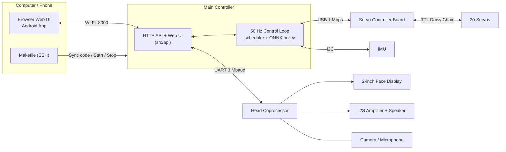
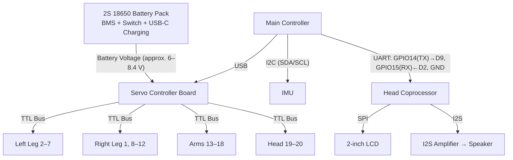

<p align="center">
  <a href="README.md">中文</a> | <a href="README.en.md"><strong>English</strong></a>
</p>

> This project was co-created by [AI Lab – FanGe](https://space.bilibili.com/2161614) and the Qiyuan Robotics team. Many thanks to the Qiyuan Robotics team for their technical support.

<div align="center">

# Xiaoxiaobai

**An open-source desktop humanoid robot, approximately 30 cm tall, that can walk, roller-skate, and perform a calisthenics routine**

<br/>
<a href="docs/videos/intro_cover.mp4">▶ HD video</a>

20 bus servos · Onboard reinforcement learning policy inference at 50 Hz · Face display + speaker + camera · Web UI and Android app

</div>

---

## Video Highlights

<table>
<tr>
<td width="50%" align="center">
<br/>
<b>Walking and skating</b>: The same hardware supports both. Put on the roller skates and switch to a skating policy for two-foot gliding or single-leg push-off skating, all controlled by reinforcement learning policies trained in simulation.<br/>
<a href="docs/videos/intro_skate.mp4">▶ HD video</a>
</td>
<td width="50%" align="center">
<br/>
<b>A playful companion</b>: It runs up to you and hugs your leg. Its face display blinks and smiles, while the camera and microphone in its head let it see, hear, and converse.<br/>
<a href="docs/videos/intro_cute.mp4">▶ HD video</a>
</td>
</tr>
<tr>
<td width="50%" align="center">
<br/>
<b>A look inside</b>: The main controller and IMU are stacked inside the torso, with the battery centered inside. The entire frame is 3D-printed, and 20 bus servos drive the robot's joints.<br/>
<a href="docs/videos/intro_exploded.mp4">▶ HD video</a>
</td>
<td width="50%" align="center">
<br/>
<b>Project overview</b>: Walking outdoors, training many robots in parallel in MuJoCo, and performing motions on a desktop. Control it through the Web UI or mobile app, or teach it new motions by physically guiding its joints.<br/>
<a href="docs/videos/intro_overview.mp4">▶ HD video</a>
</td>
</tr>
</table>

---

## Acknowledgments

Xiaoxiaobai builds on two excellent open-source projects. Special thanks to:

- **[microban](https://github.com/Rhoban/microban)** (Marc Duclusaud / the Rhoban team, LaBRI, University of Bordeaux): A fully 3D-printable, open-source miniature humanoid robot. Xiaoxiaobai's robot runtime (control loop, scheduler, servo drivers, and deployment workflow) and training environment evolved from microban and its training repository, [mjlab_microban](https://github.com/MarcDcls/mjlab_microban). See [`xiaoxiaobai/LICENSE`](xiaoxiaobai/LICENSE) for attribution.
- **[microduck](https://github.com/pollen-robotics/microduck)** (Pollen Robotics): A small bipedal robot based on bus servos and reinforcement learning. The sim-to-real techniques in its training repository, [microduck_rl](https://github.com/pollen-robotics/microduck_rl), including the BAM actuator model and domain randomization of voltage and latency, have been very helpful for training Xiaoxiaobai.

Thanks also to open-source tools including [MjLab](https://github.com/mujocolab/mjlab), [MuJoCo](https://github.com/google-deepmind/mujoco), [BAM](https://github.com/Rhoban/bam), and [rustypot](https://github.com/pollen-robotics/rustypot).

---

## Contents

- [Video Highlights](#video-highlights)
- [Project Overview](#project-overview)
- [Repository Structure](#repository-structure)
- [Assembly Guide](#assembly-guide)
- [Software Deployment](#software-deployment)
- [Usage Guide](#usage-guide)
  - [**IMU Correction (Very Important)**](#imu-correction-very-important)
- [Training Your Own Policies](#training-your-own-policies)
- [License](#license)

> **Building one from scratch?** See the Chinese replication guide [`docs/复刻指南.md`](docs/复刻指南.md) for a purchasable BOM (XL330, OpenRB-150, Pi Zero 2 W, BMI088, XIAO ESP32S3 Sense, etc.), print-plate notes, and a shortest path from parts to first walk. The Assembly Guide below remains the official mechanical/wiring reference.  
> **Brain / chat first (head + torso only)?** See [`docs/大脑复刻指南.md`](docs/大脑复刻指南.md) (Chinese): scope evaluation, `make api-dev` on a laptop, and a phased BOM without the 20 servos.

---

## Project Overview

Xiaoxiaobai is a desktop humanoid robot whose movements are driven by policies trained with reinforcement learning in MuJoCo. The policies are exported to ONNX and run directly on the main controller at 50 Hz for real-time inference.

<table>
<tr>
<td width="50%"></td>
<td width="50%"></td>
</tr>
<tr>
<td align="center">Walking policies trained in parallel in MjLab</td>
<td align="center">Skating policy with roller skates</td>
</tr>
</table>

### What It Can Do

| Capability | Description |
| :--- | :--- |
| 🚶 Walking | Two reinforcement learning gaits (Low-Battery Gait 1 / Low-Battery Gait 2) for moving forward, backward, and sideways, and turning in place; trained at supply voltages of 5–8 V to remain stable as the battery discharges |
| 🛼 Roller-skating | Two policies for use with roller skates: two-foot gliding and single-leg push-off skating |
| 🤸 Motions | An approximately 46-second calisthenics routine, peeking, propping up from / returning to a supine position, and relaxed motions while lying or sitting |
| 👋 Upper body | Arms remain free while walking: dozens of humanlike gestures such as waving, making a heart, putting hands on hips, and bowing; teach custom motions using sliders or by physically guiding the joints |
| 😊 Expressions | More than 80 dot-matrix expressions on a 2-inch display, with automatic blinking, glancing, and mouth movements synchronized to speech |
| 🗣️ Voice and conversation | Real-time voice conversations (Qwen Realtime), camera vision, and understanding and executing instructions such as “walk forward two steps” or “wave” |
| 🎵 Other features | NetEase Cloud Music playback, notes and reminders, a knowledge base, and long-term memory |
| 📱 App | Android app for network setup, Bluetooth remote control, and a following mode that detects people's legs using the phone camera |

<p align="center">
  <br/>
  <sub>A few expressions on the face display: idle, laughing, affection, blinking, dizzy, and sleeping</sub>
</p>

### Hardware at a Glance

<p align="center">
  
</p>

| Item | Specification |
| :--- | :--- |
| Height / weight | Approximately 30 cm / 1.07 kg (CAD estimate) |
| Degrees of freedom | 20: legs 6×2, arms 3×2, head 2 (yaw + pitch) |
| Servos | 20 bus servos, using a 1 Mbps bus through a servo controller board connected to the main controller via USB |
| Main controller | Main controller board, IMU (I2C) |
| Head | Head coprocessor (camera + microphone), 2-inch LCD, I2S amplifier + speaker; communicates with the main controller over UART (3 Mbaud) |
| Power | Two 18650 cells (2S1P), approximately 106 g, centered inside the torso |
| Structure | 25 3D-printed structural parts |

### System Architecture



---

## Repository Structure

| Directory | Contents |
| :--- | :--- |
| [`xiaoxiaobai/`](xiaoxiaobai/README.en.md) | Robot-side code: control loop, motions, policy models, HTTP API and Web UI, head firmware, and Android app source |
| [`mjlab_xiaoxiaobai/`](mjlab_xiaoxiaobai/README.en.md) | MjLab-based reinforcement learning training environment, robot MJCF models, and meshes |
| [`hardware/`](hardware) | 3D-printing files (Bambu Studio project) and Rhino exterior model |
| [`release/`](release) | Prebuilt Android app packages |
| [`docs/images/`](docs/images) | Images used in this document |

Keep the two code directories as siblings: the training scripts export policies to `../xiaoxiaobai/src/agents/`, and the robot-side MJCF also references meshes directly from the training directory.

---

## Assembly Guide

For a full DIY path (BOM with purchase keywords, print plates, budget, schedule), see [`docs/复刻指南.md`](docs/复刻指南.md) (Chinese). For a brain-first path (chat + head/torso only), see [`docs/大脑复刻指南.md`](docs/大脑复刻指南.md).

### 1. Gather the Parts

| Part | Quantity | Notes |
| :--- | :---: | :--- |
| Bus servo | 20 | Each servo comes with one 180 mm cable and screws |
| Idler horn | 4 | For the passive side of the dual-servo blocks at the hips and ankles |
| Main controller board + microSD card (≥16 GB) | 1 | Main controller |
| Servo controller board | 1 | Servo bus controller, connected to the main controller via USB |
| IMU module | 1 | Connects to the main controller over I2C; stacked with it inside the torso |
| Head coprocessor | 1 | With camera and microphone |
| 2-inch LCD (320×240) | 1 | Face display |
| I2S amplifier + small speaker | 1 | Speaker approximately 35×25 mm |
| 18650 lithium-ion cell | 2 | 2S1P battery pack |
| 2S BMS, USB-C charging board, power switch | 1 each | Battery management and charging |
| Φ22 × 4 mm thin-section bearing | 5 | Shaft support at both hips, both shoulders, and the head |
| M2 / M2.5 self-tapping screws, servo cables, heat-shrink tubing | As needed | Servo cables can be cut to length and re-crimped |

You will also need a 3D printer and basic tools such as a soldering iron and crimping tool.

### 2. Print the Structural Parts

The printing files and models are in [`hardware/`](hardware):

| File | Description |
| :--- | :--- |
| [`小小白3D打印.3mf`](hardware/小小白3D打印.3mf) | Bambu Studio project arranged across 5 build plates; defaults: 0.4 mm nozzle, PLA, 0.2 mm layer height, 15% infill. For other printers, select your printer in Bambu Studio / OrcaSlicer and re-slice |
| [`外形重新设计整理.3dm`](hardware/外形重新设计整理.3dm) | Rhino exterior model; start here to modify parts |

There are 25 structural parts in total; PLA is recommended. The masses below are CAD estimates. Printed masses close to these values indicate a suitable infill setting (mass affects whether a trained policy can transfer directly to the physical robot).

| Body region | Parts (mass per part) |
| :--- | :--- |
| Torso | Pelvis (36.6 g), waist (8.8 g), upper torso (71.5 g) |
| Head | Neck (6 g), head shell (40 g), head mounting plates (one each at 10 g and 15 g) |
| Arms ×2 | Shoulder (13.8 g), upper arm (6.5 g), forearm / hand (17 g) |
| Legs ×2 | Hip (11.5 g), hip dual-servo block (7.7 g), thigh (26.7 g), shin (36.4 g), ankle dual-servo block (7.7 g), foot (27.5 g) |

### 3. Configure the Servos

Configure all 20 servos individually before assembly. **Write each ID directly on the servo housing** to avoid installing a servo in the wrong location.

1. Flash the servo controller board with USB-to-servo-bus bridge firmware.
2. Connect only one servo at a time and scan using the servo configuration tool (new servos default to 57600 bps).
3. Set the **ID** according to the table below, set **Baud Rate to 1 Mbps** and **Return Delay Time to 0**, then save.
4. Before installing the servo horn, move the servo to its midpoint (Goal Position = 2048), then attach the connecting parts in the neutral standing pose. This position corresponds to a joint angle of 0 in the code.

| Joint | Right ID | Left ID |
| :--- | :---: | :---: |
| Hip yaw (rotation) | 1 | 7 |
| Hip roll (sideways swing) | 8 | 2 |
| Hip pitch (forward/backward swing) | 9 | 3 |
| Knee | 10 | 4 |
| Ankle pitch | 11 | 5 |
| Ankle roll | 12 | 6 |
| Shoulder pitch | 13 | 16 |
| Shoulder roll | 14 | 17 |
| Elbow | 15 | 18 |
| Head yaw | 19 | |
| Head pitch | 20 | |

> [!TIP]
> The authoritative joint-to-ID mapping is `MOTOR_TO_ID` in [`xiaoxiaobai/src/constants.py`](xiaoxiaobai/src/constants.py); rotation directions are defined by `MOTOR_SIGN`. If your setup differs, edit these two mappings instead of reconfiguring the servos.

### 4. Assemble the Legs


From top to bottom: hip yaw servo → hip → hip dual-servo block (hip roll + hip pitch) → thigh → knee servo → shin → ankle dual-servo block (ankle pitch + ankle roll) → foot.

- The servos in each **dual-servo block** sit very close together. **Plug in the cable between them before sliding the servos into the block**, including the cable leading to the next servo.
- Install idler horns on the passive sides of the hip and foot.
- Route cables along the channels in the thigh and shin, leaving enough slack for joint movement.
- A thin rubber layer on the soles can improve grip.

Assemble the other leg as a mirror image.

<br clear="right"/>

### 5. Assemble the Torso


- Install the two hip yaw servos (IDs 1 and 7) in the pelvis, with bearings supporting the shafts.
- The waist connects the pelvis to the upper torso.
- Install the two shoulder pitch servos (IDs 13 and 16) and head yaw servo (ID 19) in the upper torso, each with a bearing as well.
- Stack the main controller and IMU into a control module and mount it on one side of the torso. **Secure the IMU firmly**; any looseness directly affects walking.
- Place the battery pack in the center of the torso for a lower, more stable center of mass.

<br clear="right"/>

### 6. Assemble the Arms


Shoulder pitch servo (on the torso) → shoulder → shoulder roll servo → upper arm → elbow servo → forearm / hand.

Assemble the other arm as a mirror image.

<br clear="right"/>

### 7. Assemble the Head


Head yaw servo (ID 19, on the torso) → neck → head pitch servo (ID 20) → head mounting plate → face display, head coprocessor, and speaker → head shell.

**Do not insert a card** into the head board's microSD slot: it shares pins D8–D10 with the display and UART.

<br clear="right"/>

### 8. Wiring

Daisy-chain all servos, using one-to-two / one-to-three splitter cables near the torso to branch out to the limbs, and connect the chain to the servo controller board.



Head wiring:

| LCD | Head board | | I2S amplifier | Head board | | Main controller header | Head board |
| :--- | :--- | --- | :--- | :--- | --- | :--- | :--- |
| VCC | 3V3 | | VIN | 5V | | Pin 8 (GPIO14, TXD) | D9 |
| GND | GND | | GND | GND | | Pin 10 (GPIO15, RXD) | D2 |
| DIN | D10 | | BCLK | D5 | | Pin 6 (GND) | GND |
| CLK | D8 | | LRC | D6 | | Pin 2/4 (5V, optional) | 5V |
| CS | D0 | | DIN | D7 | | | |
| DC | D1 | | SD, GAIN | Leave unconnected | | | |
| RST | D3 | | | | | | |
| BL | D4 | | | | | | |

Connect UART TX to RX and RX to TX, and connect the grounds together. The main controller requires a stable 5 V supply; step down the battery voltage according to your power design (the diagram above shows only signal connections and servo power). If the head board is powered from the main controller's 5V supply, disconnect that 5V wire before plugging in USB to flash the head firmware.

> [!WARNING]
> When soldering splitter cables, always connect wires with matching signal names. Incorrect wiring can permanently damage the servos. Insulate all solder joints with heat-shrink tubing or hot glue.

### 9. Power-On Checks

After assembly, run these checks in order before attempting to walk (first complete [Software Deployment](#software-deployment) below):

| Command | What to check |
| :--- | :--- |
| `make voltage` | Voltage readings from all servos confirm that the bus and IDs are correct |
| `make imu` | IMU readings update normally and change when you tilt the robot |
| `make direction-check` | Compare each joint's rotation direction in MuJoCo and on the real robot to verify `MOTOR_SIGN` |
| `make motor-check` | Run with the robot **suspended off the ground** to check that every servo produces torque correctly |

---

## Software Deployment

### 1. Flash the Raspberry Pi OS Image

There are two options: flash the Xiaoxiaobai image directly (recommended), or flash the official OS image and configure it manually.

**Option 1: Flash the Xiaoxiaobai image (recommended)**

The image is based on the official Raspberry Pi OS Lite (64-bit). It includes the robot code, dependencies, and ffmpeg; I2C, SPI, and UART are enabled; and the API / Web UI and Bluetooth network setup start automatically on boot. You can skip steps 3 and 6 below.

1. Download `xiaoxiaobai-<date>.img.xz` from this repository's Releases page. There is no need to extract it. Images you build yourself (see step 8) are stored in `xiaoxiaobai/build/image/` and work the same way.
2. Open [Raspberry Pi Imager](https://www.raspberrypi.com/software/): select your main controller model, scroll to the bottom of the OS list and choose “Use custom”, select the downloaded image, then select your SD card (≥16 GB).
3. When asked whether to apply OS customization settings, select **No**. The image is already configured; customization would overwrite its settings.
4. After writing, remove and reinsert the SD card. Open `network-config` on the `bootfs` partition and replace `YOUR_WIFI_NAME` and `YOUR_WIFI_PASSWORD` with your Wi-Fi network name and password. **Wi-Fi must be 2.4 GHz**; the main controller cannot connect to 5 GHz networks (set phone hotspots to 2.4 GHz as well). Alternatively, skip this step and configure Wi-Fi over Bluetooth using the mobile app after booting.
5. Insert the card and power on. The partition expands automatically on first boot, which takes 1–2 minutes. Do not disconnect power during this process.

The default username is `user`, the password is `password`, and the hostname is `xiaoxiaobai`. Run `passwd` after your first login to change the password. To change Wi-Fi networks later, edit `network-config` and reboot (the robot will automatically reboot once more).

After 2–3 minutes, run `ping xiaoxiaobai.local` on your computer. A response confirms that the robot is connected to Wi-Fi. If `.local` does not work, find the device named `xiaoxiaobai` in your router's administration page and check its IP address.

**Cannot connect to Wi-Fi: use a monitor and nmcli**

If `network-config` is incorrect, the network uses 5 GHz, or Bluetooth setup also fails, configure the network directly on the robot:

1. Connect the main controller to a monitor using a mini HDMI cable (or adapter). Connect a keyboard to its USB data port (not the power port) using a USB OTG adapter, then power on.
2. When the login prompt appears, log in with `user` / `password`.
3. Run:

   ```bash
   sudo rfkill unblock wifi                                      # Make sure Wi-Fi is not blocked
   sudo nmcli device wifi rescan
   nmcli device wifi list                                        # Find your network; CHAN 1–13 indicates 2.4 GHz
   sudo nmcli device wifi connect "YOUR_WIFI_NAME" password "YOUR_WIFI_PASSWORD"
   hostname -I                                                   # Note the first address: the robot's IP
   ```

   - For a hidden network, append `hidden yes` to the `connect` line.
   - Keep the double quotes around names or passwords containing spaces or special characters.
   - If your network is missing from the list, it is likely a 5 GHz network or the router is too far away. Outside China, run `sudo iw reg set US` first (replace `US` with your country's code), then `rescan`.
   - If you get a password error, use `nmcli connection show` to find the newly created connection, delete it with `sudo nmcli connection delete "<connection-name>"`, then run `connect` again.

4. The configuration is saved and reconnects automatically after a reboot. Disconnect the monitor and keyboard, and continue the steps below from your computer using the IP address you noted. The head board automatically uses the Wi-Fi settings saved on the main controller; no separate setup is required.

**Option 2: Flash the official OS and configure it manually**

1. In [Raspberry Pi Imager](https://www.raspberrypi.com/software/), select your main controller model → Raspberry Pi OS Lite (64-bit).
2. In OS customization, set the hostname to `xiaoxiaobai`, set your username and password, configure Wi-Fi, and enable SSH.
3. **Wi-Fi must be 2.4 GHz**; the main controller cannot connect to 5 GHz networks (set phone hotspots to 2.4 GHz as well).
4. Insert the card and power on. First boot takes 1–2 minutes; do not disconnect power during this process.

### 2. Configure SSH

Add the following to `~/.ssh/config` on your computer (`Makefile` connects to the host `xiaoxiaobai` by default; override it with `HOST=...`):

```
Host xiaoxiaobai
    HostName <robot-ip>
    User <your-username>
```

If you flashed the Xiaoxiaobai image, the username is `user`.

Remote commands such as `make setup` and `make run` use the SSH alias `xiaoxiaobai` configured above by default. The username and IP address are read from this configuration, so you do not need to repeat `user@IP`. First run `ssh xiaoxiaobai` to confirm that you can log in, then enter `exit` to return to your computer before running the `make` commands.

**You can also work without an SSH alias**: from the `xiaoxiaobai/` code directory on your computer, explicitly pass `HOST=username@hostname-or-IP` each time you run a remote command. After flashing the Xiaoxiaobai image, if your computer and robot are on the same local network and your computer can resolve `xiaoxiaobai.local`, run:

```bash
make setup HOST=user@xiaoxiaobai.local
make run HOST=user@xiaoxiaobai.local
```

These are two separate commands. Run them one after the other; do not add a trailing backslash `\`. If you used the official OS image, replace `user` with the username you configured.

If `.local` cannot be resolved, use the robot's actual IP address instead. For example (replace the example IP with the robot's actual IP):

```bash
make setup HOST=user@192.168.1.100
make run HOST=user@192.168.1.100
make stop HOST=user@192.168.1.100
```

`HOST=...` applies only to the current command. Include it in subsequent remote commands such as `make sync` and `make app-enable` as well. Do not write `make run user@IP`. If you supply only an IP address without a username, SSH will usually use your computer's current username, which may cause login to fail. If the robot's IP changes, update your SSH configuration or the IP in your commands.

Then copy your SSH key so that you do not have to enter a password each time:

```bash
ssh-keygen -t ed25519      # Skip if you already have a key
ssh-copy-id xiaoxiaobai
```

**After replacing the SD card or reflashing the OS**: the robot generates a new SSH host key. Your computer will report `REMOTE HOST IDENTIFICATION HAS CHANGED` and refuse to connect. Remove the old entries before running `ssh-copy-id` again:

```bash
ssh-keygen -R xiaoxiaobai
ssh-keygen -R xiaoxiaobai.local
ssh-keygen -R <robot-ip>
```

### 3. Configure Raspberry Pi Interfaces

Skip this step if you flashed the Xiaoxiaobai image. For a manual installation, SSH into the Raspberry Pi and run:

```bash
sudo raspi-config
#   Interface Options → I2C → Enable
#   Interface Options → Serial Port → Login shell: No; serial hardware: Yes
```

Make sure the `[all]` section of `/boot/firmware/config.txt` contains:

```
dtparam=i2c_arm=on
dtparam=i2c_arm_baudrate=400000
enable_uart=1
dtoverlay=miniuart-bt
```

Then run:

```bash
sudo usermod -aG dialout,i2c,input $USER                            # Serial, I2C, and gamepad permissions
sudo nmcli con mod <your-Wi-Fi-connection-name> wifi.powersave disable  # Prevent SSH from stalling when idle
curl -LsSf https://astral.sh/uv/install.sh | sh                      # Install uv
sudo reboot
```

### 4. Sync Code from Your Computer

Install [uv](https://docs.astral.sh/uv/) on your computer as well, then run:

```bash
git clone <repository-url>
cd <repository-directory>/xiaoxiaobai
make setup          # Sync code to the robot and install dependencies (uv sync --frozen)
```

The Xiaoxiaobai image already contains the code and dependencies, so `make setup` only updates the robot to the version on your computer and should finish quickly. After making further code changes, use `make sync` to sync them.

### 5. Flash the Head Firmware

For the first flash, connect the head coprocessor to your computer with a USB cable (requires [arduino-cli](https://arduino.github.io/arduino-cli/) and the board core for your head board):

```bash
make firmware-upload ESP32_PORT=/dev/ttyACM0
```

For later updates, use `make firmware-uart` to flash the head through the main controller's UART without disassembling the head.

### 6. Install the Mobile App (Optional)

Install `小小白-1.0.3.apk` from [`release/`](release). If you flashed the Xiaoxiaobai image, the app is ready to use after installation. For a manual installation, also run the following once to configure the robot:

```bash
make app-enable     # Enable Bluetooth on boot, network setup permissions, and the API service
```

The app is essentially a wrapper around the robot's Web UI, with Bluetooth remote control and phone-camera following added. Updating the Web UI does not require reinstalling the app.

### 7. Replace the SD Card

If the robot is already assembled and you are replacing the SD card (or reflashing the OS), follow this sequence. IMU calibration and corrections, the LLM API key, and Web UI settings are stored in `~/.config/xiaoxiaobai/` on the robot. They reside on the SD card and will not be present on a new card. The head firmware is stored on the head board and is unaffected by replacing the card.

1. **Back up settings from the old card** (if it still boots):

   ```bash
   scp -r xiaoxiaobai:.config/xiaoxiaobai ~/xiaoxiaobai-config-backup
   ```

2. **Flash the image, enter Wi-Fi settings, and boot**: follow option 1 in step 1. If Wi-Fi does not connect, attach a monitor and configure it with nmcli.
3. **Reconnect over SSH**: follow step 2. Remove old host entries with `ssh-keygen -R`, run `ssh-copy-id xiaoxiaobai`, then change the default password with `ssh xiaoxiaobai passwd`.
4. **Sync the code**: `make setup`.
5. **Restore settings** (only if you made the backup in item 1):

   ```bash
   scp -r ~/xiaoxiaobai-config-backup/. xiaoxiaobai:.config/xiaoxiaobai/
   ssh xiaoxiaobai sudo systemctl restart xiaoxiaobai-api
   ```

6. **Head firmware**: skip if already flashed. Follow step 5 only if the head board is new or the firmware has changed.
7. **Power-on checks**: follow step 9 of the assembly guide and run `make voltage`, `make imu`, and `make motor-check` (with the robot suspended) in order. If the serial port is reported as busy, run `make stop` first.
8. **Stand up and correct the IMU**: run `make run`. Follow the [Usage Guide](#usage-guide): stand the robot up, perform IMU mounting calibration, then walk and manually adjust and save roll / pitch corrections. If you restored settings, walk briefly to confirm they still work; there is no need to retune.
9. **Mobile app**: install the APK from `release/`. The image already enables Bluetooth and startup services.
10. **Shut down**: run `make shutdown`, wait 10–15 seconds, then switch off the power.

### 8. Build Your Own Image (Optional)

To package your code changes into an image, run the following on a Linux computer (on x86 computers, first run `sudo apt install qemu-user-static` to execute the image's arm64 programs):

```bash
cd xiaoxiaobai
make image          # Requires sudo, internet access, and approximately 10 GB of disk space
```

[`image/build.sh`](xiaoxiaobai/image/build.sh) downloads the official Raspberry Pi OS Lite image and verifies its SHA256, installs the code, dependencies, and startup services, and produces `build/image/xiaoxiaobai-<date>.img.xz` and its `.sha256` file. It packages the current code on your computer, so rebuild after changing the code. The process takes approximately 20–30 minutes, most of it spent running `uv sync` inside the image.

After building:

1. **Verify** (optional, but recommended after copying to another computer or downloading):

   ```bash
   cd build/image
   sha256sum -c xiaoxiaobai-<date>.img.xz.sha256      # An OK result confirms integrity
   ```

2. **Flash**: follow option 1 in step 1. Choose “Use custom” in Raspberry Pi Imager, select the `.img.xz`, decline OS customization, then edit `network-config` in `bootfs`. On Linux, you can also write the card from the command line:

   ```bash
   lsblk                                              # Identify the SD card device first, e.g. /dev/sdb
   xz -dc build/image/xiaoxiaobai-<date>.img.xz | sudo dd of=/dev/sdX bs=4M conv=fsync status=progress
   ```

   Replace `/dev/sdX` with the SD card device itself (not a partition such as `/dev/sdb1`). Choosing the wrong device will erase that drive. Reinsert the card after writing and edit `network-config` as usual.

3. **Share the image**: upload both `.img.xz` and `.img.xz.sha256` to the GitHub repository's Releases. Others can download and flash them using option 1. Each GitHub release asset must be no larger than 2 GB. With [GitHub CLI](https://cli.github.com/):

   ```bash
   gh release create v<version> build/image/xiaoxiaobai-<date>.img.xz build/image/xiaoxiaobai-<date>.img.xz.sha256
   ```

Build notes:

- The Raspberry Pi OS and uv archives in `build/image/` are download caches. Subsequent builds verify and reuse them, so do not delete them.
- During the build, the image is mounted at `build/image/mnt`. Do not `cd` into it in a terminal or let an editor index it (in Cursor, add `xiaoxiaobai/build/` to `.cursorignore` at the repository root), or the final unmount will fail with “target is busy”. Also avoid running terminal commands through Cursor's Agent during the build: its sandbox copies the current mounts, keeping the image partition busy and causing a final `e2fsck: Cannot continue, aborting` error.
- If a build is interrupted and `mnt` is not fully unmounted, unmount it, remove the old image, then rerun `make image`:

  ```bash
  sudo umount -R -l build/image/mnt
  losetup -j build/image/xiaoxiaobai-<date>.img      # Find the image's loop device, e.g. /dev/loop26
  sudo losetup -d /dev/loopN                         # Use the device found above; a busy error can be ignored
  sudo rm -f build/image/xiaoxiaobai-*.img build/image/xiaoxiaobai-*.img.xz*
  sudo rmdir build/image/mnt
  ```

---

## Usage Guide

### Start Up

```bash
make run
```

`make run` syncs the code, starts the API and Web UI on the robot, and opens the control panel in your computer's browser. A phone on the same local network can also control the robot at `http://<robot-ip>:8000`. To start the service automatically on boot, run `make api-enable` once.

<p align="center">
  
</p>

### Stand and Walk for the First Time

The Web UI labels and screenshots are currently in Chinese. English translations below retain the Chinese labels where needed so you can locate the controls.

1. Place the robot on a flat floor (or support it with your hand).
2. On the home page, click **Stand (站立)**: the servos engage and slowly return to the neutral standing pose (position-controlled standing).
3. Click **Walk/Run (走跑)**: the walking policy starts, and the robot steps in place to maintain balance.
4. Use the on-screen joystick or keyboard `WASD` / `QE` to move forward/backward, sideways, and turn. Release to stop.
5. At any time, click the red **Emergency Stop (急停)** in the upper-right corner, or press `Esc` twice, to immediately disable torque on all servos.

| Mode | Description |
| :--- | :--- |
| Stand / Position-Controlled Standing (站立 / 位控站立) | Holds the neutral standing pose without active balancing |
| Walk/Run (走跑) | Reinforcement learning walking policy that accepts velocity commands |
| Walk/Run · Free Upper Body (走跑·上肢自由) | Legs walk while the arms and head perform gestures, idle motions, or manually specified joint angles |
| Roller-skating (滑板) | For use with roller skates: forward skating only (0–0.5 m/s), plus turning |
| Calisthenics / Peek (广播体操 / 偷看) | Performs a complete routine from a standing pose, then returns to balancing in place |
| Prop Up / Lie Down, Relax While Lying, Relax While Sitting (撑起 / 躺下、躺着休闲、坐地休闲) | Motions performed from a supine starting position |
| Zero Torque (零力矩) | Stops the control loop and disables torque on all servos |

### IMU Correction (Very Important)

> [!IMPORTANT]
> **After deploying a gait, you must correct the IMU by manually adjusting its pitch and roll corrections.**
>
> **Even a 1° mounting error makes the “body orientation” seen by the policy incorrect: the robot may lean to one side, drift while walking, lurch forward, or lean backward. In severe cases, it will fall. This step determines whether the trained policy can walk stably on your robot, so take the time to do it carefully.**

Find the correction controls in the Web UI under **Motion (运动)** → **Walking Tuning (走路调校)**:

<p align="center">
  
</p>

**Step 1: Perform IMU mounting calibration once (④ in the image)**

Switch to **Position-Controlled Standing (位控站立)**, place the robot on a **level, flat surface**, remove your hands, and click **Start Calibration (开始标定)**. This takes about 3 seconds. It measures and saves the IMU's mounting offset relative to the torso. Repeat after replacing the IMU, disassembling and reassembling the robot, or a fall. Calibration resets the manual corrections to zero.

**Step 2: Walk and observe the posture (⑤ in the image)**

Switch to **Walk/Run (走跑)** and have the robot **walk straight forward and backward** for a short distance each. Watch both **Current Orientation (当前姿态)** at the bottom of the card and the robot's actual behavior.

**Step 3: Manually adjust roll and pitch (② and ③ in the image)**

| What you observe | Control to adjust | Adjustment |
| :--- | :--- | :--- |
| **Body leans / drifts to the right** | **IMU Roll Correction (IMU 横滚校正)** | **Adjust toward +** (+ corrects the body toward the left) |
| **Body leans / drifts to the left** | **IMU Roll Correction (IMU 横滚校正)** | **Adjust toward −** |
| **Keeps lurching / falling forward** | **IMU Pitch Correction (IMU 俯仰校正)** | **Adjust toward −** |
| **Keeps leaning / falling backward** | **IMU Pitch Correction (IMU 俯仰校正)** | **Adjust toward +** (+ corrects the body forward) |

- **Rule of thumb: correct in the opposite direction to the lean.**
- **Change only 0.5°–1° at a time.** After moving the slider, click **Save (保存)** below it to apply the change. The range is ±6°.
- **You can adjust while walking; saved changes take effect immediately**, without stopping. They are stored on the robot and persist across reboots.
- **Adjust roll first, then pitch**, changing only one axis at a time. Walk several times after each change before judging the result.
- These corrections **apply to walking, roller-skating, calisthenics, and peeking alike**. If the robot repeatedly falls forward during a routine, adjust pitch in the negative direction as well.

**Supporting tools**

- **Automatic IMU Correction (IMU 自动修正)** (enabled by default): makes small automatic adjustments on top of the manual corrections during steady, straight walking (up to ±3° roll and ±2° pitch). IMU mounting calibration must be completed first. It only compensates for slowly accumulating drift and **does not replace manual correction**.
- **Mirror Policy Left/Right (策略左右镜像)** (diagnostic): reset roll correction to 0, enable mirroring, and walk again. If the drift switches sides, the policy is the cause. If it does not, the cause is in the robot itself (center of mass, assembly, or IMU mounting).
- **Voltage Compensation KP (电压补偿 KP)** (enabled by default): automatically increases servo stiffness during walking as the battery voltage drops, preventing the body from gradually leaning at low battery levels.

### Switch Walking and Skating Policies

Select policies at the top of the same **Walking Tuning (走路调校)** card. Switching while walking takes effect immediately:

| Name | File | Description |
| :--- | :--- | :--- |
| Low-Battery Gait 1 (低电量步态1, default) | `walk_low_battery_1.onnx` | Natural gait trained over a supply voltage range of 5–8 V |
| Low-Battery Gait 2 (低电量步态2) | `walk_low_battery_2.onnx` | Builds on Gait 1 with training that includes battery voltage drops during walking, improving stability as voltage falls |
| Two-Foot Gliding (双脚滑行, default) | `skate_glide.onnx` | Both feet glide along the ground; trained down to 5.5 V |
| Single-Leg Push-Off (单脚蹬滑) | `skate_single_leg.onnx` | One foot pushes off while the other glides on its own, like a human skater |

### Voice Conversations and LLMs

```bash
make voice-key      # One-time setup: save your Qwen API key on the robot
```

Then type in the Web UI chat box or click the microphone to speak. Under **Settings (设置)** → **LLM (大模型)**, you can select other models and toggle web search and **Voice Motion Commands (语音指挥动作)**. With voice motion commands enabled, say “walk forward two steps” or “wave”, and the robot will plan and execute the motion.

### Shut Down

> [!CAUTION]
> Always run `make shutdown` before cutting power. Wait 10–15 seconds before switching off the power. Cutting power directly may damage the SD card.

### Common Commands

| Command | Purpose |
| :--- | :--- |
| `make run` | Sync code, start the API + Web UI, and open the browser |
| `make stop` | Stop the control loop and disable servo torque |
| `make api-enable` / `make api-disable` | Enable / disable the API service at boot |
| `make api-dev` | Run the Web UI in mock mode on your computer (no hardware required) |
| `make sim` | Run the complete control code in MuJoCo |
| `make camera` | View the head camera in a browser |
| `make music-setup` | One-time setup: install ffmpeg for the music page |
| `make firmware-uart` | Compile the head firmware and update it through the main controller's UART |
| `make app-apk` | Build the Android app |
| `make shutdown` | Shut down safely |

See [`xiaoxiaobai/Makefile`](xiaoxiaobai/Makefile) for the full command list.

---

## Training Your Own Policies

The training environment is in [`mjlab_xiaoxiaobai/`](mjlab_xiaoxiaobai/README.en.md) and requires an NVIDIA GPU:

```bash
cd mjlab_xiaoxiaobai
uv sync
uv run train Mjlab-Velocity-Xiaoxiaobai --env.scene.num-envs 4096      # Train walking
uv run play Mjlab-Velocity-Xiaoxiaobai --checkpoint-file <checkpoint>   # Replay
uv run python src/mjlab_xiaoxiaobai/scripts/export_onnx.py \
    --checkpoint <checkpoint> --output ../xiaoxiaobai/src/agents/my_walk.onnx
```

After exporting, add the filename to `WALK_AGENTS` in [`xiaoxiaobai/src/constants.py`](xiaoxiaobai/src/constants.py) to make it selectable in the Web UI. After deploying a new policy, **remember to recheck the IMU corrections using the procedure above**.

For more tasks (roller-skating, calisthenics, peeking, propping up, etc.), see [`mjlab_xiaoxiaobai/README.en.md`](mjlab_xiaoxiaobai/README.en.md).

---

## License

- `xiaoxiaobai/`: GNU GPL v3; see [`xiaoxiaobai/LICENSE`](xiaoxiaobai/LICENSE). The Noto Sans SC font in `src/fonts/` uses the SIL Open Font License.
- `mjlab_xiaoxiaobai/`: GNU GPL v3; see [`mjlab_xiaoxiaobai/LICENSE`](mjlab_xiaoxiaobai/LICENSE).
- `hardware/` (3D models and printing files): CC BY-NC-SA 4.0; see [`hardware/LICENSE`](hardware/LICENSE).

The software is licensed under GPL v3: anyone distributing this project's code or modified versions (including OS images, APKs, or software sold with a robot) must make the complete source code available under GPL v3. The hardware is licensed under CC BY-NC-SA 4.0: you may print and modify it freely, but commercial use is not permitted; shared modifications must include attribution and use the same license.

Some code is adapted from Marc Duclusaud's microban (GPL v3) and mjlab_microban (Apache License 2.0). See [`xiaoxiaobai/LICENSE`](xiaoxiaobai/LICENSE) and [`mjlab_xiaoxiaobai/LICENSE`](mjlab_xiaoxiaobai/LICENSE) for attribution. The original Apache 2.0 license for mjlab_microban is retained in [`mjlab_xiaoxiaobai/LICENSE.Apache-2.0`](mjlab_xiaoxiaobai/LICENSE.Apache-2.0).
