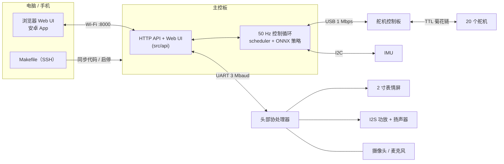
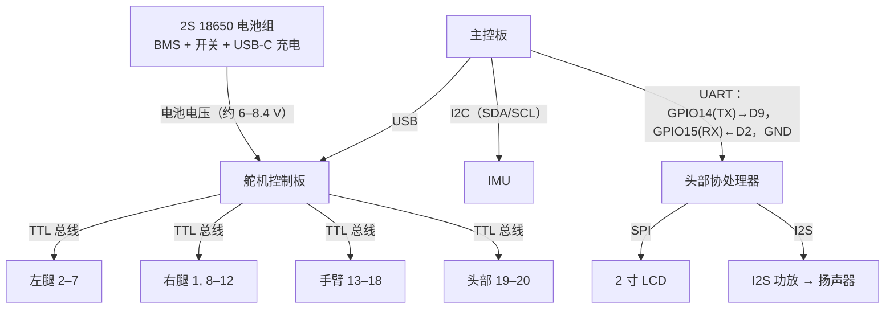

<p align="center">
  <a href="README.md"><strong>中文</strong></a> | <a href="README.en.md">English</a>
</p>

> 此项目由 [AI研究室-帆哥](https://space.bilibili.com/2161614) 和启元机器人团队共创完成，感谢启元机器人团队的技术支持。

<div align="center">

# 小小白 Xiaoxiaobai

**一个约 30 cm 高、会走路、会滑板、会做广播体操的开源桌面人形机器人**

<br/>
<a href="docs/videos/intro_cover.mp4">▶ 高清视频</a>

20 个总线舵机 · 主控板端侧 50 Hz 强化学习策略 · 表情屏 + 扬声器 + 摄像头 · Web UI 与安卓 App

</div>

---

## 视频速览

<table>
<tr>
<td width="50%" align="center">
<br/>
<b>会走也会滑</b>：同一套硬件，换上滑板鞋就切到滑板策略，双脚滑行或单脚蹬滑，全部由仿真里训练的强化学习策略控制。<br/>
<a href="docs/videos/intro_skate.mp4">▶ 高清视频</a>
</td>
<td width="50%" align="center">
<br/>
<b>会卖萌</b>：跑到你脚边、抱住你的腿，表情屏会眨眼、会笑，头部摄像头和麦克风让它能看、能听、能对话。<br/>
<a href="docs/videos/intro_cute.mp4">▶ 高清视频</a>
</td>
</tr>
<tr>
<td width="50%" align="center">
<br/>
<b>拆开看</b>：主控板和 IMU 叠放在躯干里，电池内置在躯干中间，骨架全部 3D 打印，20 个总线舵机驱动全身关节。<br/>
<a href="docs/videos/intro_exploded.mp4">▶ 高清视频</a>
</td>
<td width="50%" align="center">
<br/>
<b>整体介绍</b>：户外行走、在 MuJoCo 里成群训练、桌面上做动作，用 Web UI 和手机 App 控制，还能手把手示范教它新动作。<br/>
<a href="docs/videos/intro_overview.mp4">▶ 高清视频</a>
</td>
</tr>
</table>

---

## 致谢

小小白站在两个优秀开源项目的肩膀上，在此特别感谢：

- **[microban](https://github.com/Rhoban/microban)**（Marc Duclusaud / Rhoban 团队，波尔多大学 LaBRI）：一款完全可 3D 打印的开源小型人形机器人。小小白的机器人端运行代码（控制循环、调度器、舵机驱动、部署流程）和训练环境都从 microban 及其训练仓库 [mjlab_microban](https://github.com/MarcDcls/mjlab_microban) 演化而来，来源说明见 [`xiaoxiaobai/LICENSE`](xiaoxiaobai/LICENSE)。
- **[microduck](https://github.com/pollen-robotics/microduck)**（Pollen Robotics）：基于总线舵机和强化学习的小型双足机器人，其训练仓库 [microduck_rl](https://github.com/pollen-robotics/microduck_rl) 的 sim-to-real 经验（BAM 执行器模型、电压与延迟域随机化等）对小小白的训练帮助很大。

同时感谢 [MjLab](https://github.com/mujocolab/mjlab)、[MuJoCo](https://github.com/google-deepmind/mujoco)、[BAM](https://github.com/Rhoban/bam)、[rustypot](https://github.com/pollen-robotics/rustypot) 等开源工具。

---

## 目录

- [视频速览](#视频速览)
- [项目介绍](#项目介绍)
- [仓库结构](#仓库结构)
- [组装说明](#组装说明)
- [软件部署](#软件部署)
- [使用教学](#使用教学)
  - [**IMU 校正（非常重要）**](#imu-校正非常重要)
- [训练自己的策略](#训练自己的策略)
- [License](#license)

> **想从零复刻一台？** 先看 [`docs/复刻指南.md`](docs/复刻指南.md)：含可采购 BOM（XL330 / OpenRB-150 / Pi Zero 2 W / BMI088 / XIAO ESP32S3 Sense 等）、购买关键词、3D 打印分盘说明、装配与刷机最短路径。下面「组装说明」仍是官方装配与接线细则。

---

## 项目介绍

小小白是一个桌面级的人形机器人，所有运动都由在 MuJoCo 里用强化学习训练出来的策略驱动，策略导出为 ONNX 后直接在主控板上以 50 Hz 实时推理。

<table>
<tr>
<td width="50%"></td>
<td width="50%"></td>
</tr>
<tr>
<td align="center">MjLab 中并行训练的行走策略</td>
<td align="center">穿滑板鞋的滑行策略</td>
</tr>
</table>

### 它能做什么

| 能力 | 说明 |
| :--- | :--- |
| 🚶 行走 | 两套强化学习步态（低电量步态1 / 低电量步态2），前后左右走和原地转向，在 5–8 V 供电下训练，电量下降时依然稳定 |
| 🛼 滑板 | 穿上滑板鞋后的双脚滑行和单脚蹬滑两套策略 |
| 🤸 动作 | 约 46 秒的广播体操、探头偷看、仰躺撑起 / 躺下、躺着 / 坐着休闲等动作 |
| 👋 上肢 | 走路时手臂自由：挥手、比心、叉腰、鞠躬等几十种拟人手势，也可以用滑条或手掰示教自己的动作 |
| 😊 表情 | 2 寸屏上 80 多种点阵表情，自动眨眼、扫视，说话时嘴型跟着声音动 |
| 🗣️ 语音与对话 | 实时语音对话（通义千问 Realtime），能看摄像头画面，能听懂「往前走两步」「挥挥手」并执行 |
| 🎵 其他 | 网易云音乐播放、备忘录与提醒、知识库、长期记忆 |
| 📱 App | 安卓 App：配网、蓝牙遥控，以及用手机摄像头识别人腿的跟随模式 |

<p align="center">
  <br/>
  <sub>表情屏上的几种表情：待机、大笑、喜欢、眨眼、晕、睡觉</sub>
</p>

### 硬件一览

<p align="center">
  
</p>

| 项目 | 参数 |
| :--- | :--- |
| 身高 / 重量 | 约 30 cm / 约 1.07 kg（CAD 估算） |
| 自由度 | 20：腿 6×2、手臂 3×2、头部 2（左右 + 俯仰） |
| 舵机 | 总线舵机 × 20，经舵机控制板以 1 Mbps 走 USB 连接主控 |
| 主控 | 主控板，IMU（I2C） |
| 头部 | 头部协处理器（摄像头 + 麦克风）、2 寸 LCD、I2S 功放 + 扬声器，经 UART（3 Mbaud）与主控通信 |
| 电源 | 2 节 18650（2S1P），约 106 g，居中放在躯干内 |
| 结构 | 25 个 3D 打印结构件 |

### 系统架构



---

## 仓库结构

| 目录 | 内容 |
| :--- | :--- |
| [`xiaoxiaobai/`](xiaoxiaobai) | 机器人端代码：控制循环、动作、策略模型、HTTP API 与 Web UI、头部固件、安卓 App 源码 |
| [`mjlab_xiaoxiaobai/`](mjlab_xiaoxiaobai) | 基于 MjLab 的强化学习训练环境、机器人 MJCF 模型和网格 |
| [`hardware/`](hardware) | 3D 打印文件（Bambu Studio 工程）和 Rhino 外形模型 |
| [`release/`](release) | 编译好的安卓 App 安装包 |
| [`docs/images/`](docs/images) | 本文档用到的图片 |

两个代码目录需要放在同一级：训练脚本把导出的策略写到 `../xiaoxiaobai/src/agents/`，机器人端的 MJCF 也直接引用训练目录里的网格。

---

## 组装说明

完整复刻流程（选型依据、预算、打印盘名、采购渠道、日程）见 **[`docs/复刻指南.md`](docs/复刻指南.md)**。

### 1. 准备材料

| 部件 | 数量 | 说明 |
| :--- | :---: | :--- |
| 总线舵机 | 20 | 每个舵机自带一根 180 mm 线和螺丝 |
| 惰轮舵盘 | 4 | 髋部和脚踝双舵机块的从动侧 |
| 主控板 + microSD 卡（≥16 GB） | 1 | 主控 |
| 舵机控制板 | 1 | 舵机总线控制板，USB 接主控 |
| IMU 模块 | 1 | 接主控 I2C，和主控叠放在躯干中 |
| 头部协处理器 | 1 | 带摄像头和麦克风 |
| 2 寸 LCD（320×240） | 1 | 表情屏 |
| I2S 功放 + 小扬声器 | 1 | 约 35×25 mm 的扬声器 |
| 18650 锂电池 | 2 | 2S1P 电池组 |
| 2S BMS、USB-C 充电板、电源开关 | 各 1 | 电池管理与充电 |
| Φ22 × 4 mm 薄壁轴承 | 5 | 两侧髋部、两侧肩部、头部的转轴支撑 |
| M2 / M2.5 自攻螺丝、舵机线、热缩管 | 若干 | 舵机线可以按长度重新压接 |

另外需要一台 3D 打印机，以及电烙铁、压线钳等基本工具。

### 2. 打印结构件

打印文件和模型都在 [`hardware/`](hardware) 里：

| 文件 | 说明 |
| :--- | :--- |
| [`小小白3D打印.3mf`](hardware/小小白3D打印.3mf) | Bambu Studio 工程，已排好 5 个打印盘；默认 0.4 mm 喷嘴、PLA、0.2 mm 层高、15% 填充。其他打印机可以在 Bambu Studio / OrcaSlicer 里换机型后重新切片 |
| [`外形重新设计整理.3dm`](hardware/外形重新设计整理.3dm) | Rhino 外形模型，想修改零件可以从这里开始 |

一共 25 个结构件，推荐 PLA。下表的质量是 CAD 估算值，打印后差别不大说明填充率合适（质量会影响训练出来的策略能否直接迁移到实机）。

| 部位 | 零件（单件质量） |
| :--- | :--- |
| 躯干 | 骨盆（36.6 g）、腰部（8.8 g）、上半躯干（71.5 g） |
| 头部 | 脖子（6 g）、头壳（40 g）、头部固定板（10 g、15 g 各一） |
| 手臂 ×2 | 肩（13.8 g）、上臂（6.5 g）、前臂 / 手（17 g） |
| 腿 ×2 | 髋（11.5 g）、髋部双舵机块（7.7 g）、大腿（26.7 g）、小腿（36.4 g）、踝部双舵机块（7.7 g）、脚（27.5 g） |

### 3. 配置舵机

装配之前，先把 20 个舵机逐个配置好。**建议把 ID 直接写在舵机外壳上**，避免装错。

1. 给舵机控制板烧录 USB 转舵机总线的桥接固件。
2. 每次只接一个舵机，用舵机配置工具扫描（新舵机默认 57600 bps）。
3. 按下表设置 **ID**，**Baud Rate 设为 1 Mbps**，**Return Delay Time 设为 0**，保存。
4. 装舵盘之前，把舵机转到中位（Goal Position = 2048），再按中立站姿装上连接件。代码里关节角 0 就对应这个位置。

| 关节 | 右侧 ID | 左侧 ID |
| :--- | :---: | :---: |
| 髋 yaw（转体） | 1 | 7 |
| 髋 roll（侧摆） | 8 | 2 |
| 髋 pitch（前后摆） | 9 | 3 |
| 膝 | 10 | 4 |
| 踝 pitch | 11 | 5 |
| 踝 roll | 12 | 6 |
| 肩 pitch | 13 | 16 |
| 肩 roll | 14 | 17 |
| 肘 | 15 | 18 |
| 头部左右（yaw） | 19 | |
| 头部俯仰（pitch） | 20 | |

> [!TIP]
> ID 和关节的对应关系以 [`xiaoxiaobai/src/constants.py`](xiaoxiaobai/src/constants.py) 里的 `MOTOR_TO_ID` 为准，转向以 `MOTOR_SIGN` 为准。如果你的接法不同，改这两个表即可，不用重新配置舵机。

### 4. 组装腿部


从上到下：髋 yaw 舵机 → 髋 → 髋部双舵机块（髋 roll + 髋 pitch）→ 大腿 → 膝舵机 → 小腿 → 踝部双舵机块（踝 pitch + 踝 roll）→ 脚。

- **双舵机块**里两个舵机挨得很近，要**先把中间那根舵机线插好再把舵机推进去**，包括连到下一个舵机的线。
- 髋和脚的从动侧装惰轮舵盘。
- 线沿着大腿、小腿上的走线槽布置，留够关节转动的余量。
- 脚底可以贴一层薄橡胶增加摩擦。

另一条腿镜像组装。

<br clear="right"/>

### 5. 组装躯干


- 骨盆里装两个髋 yaw 舵机（ID 1、7），用轴承支撑转轴。
- 腰部连接骨盆和上半躯干。
- 上半躯干装两个肩 pitch 舵机（ID 13、16）和头部左右舵机（ID 19），同样各配一个轴承。
- 主控板和 IMU 叠成控制板模块装在躯干一侧。**IMU 必须牢牢固定**，松动会直接影响走路。
- 电池组放在躯干中间，重心更低更稳。

<br clear="right"/>

### 6. 组装手臂


肩 pitch 舵机（在躯干上）→ 肩 → 肩 roll 舵机 → 上臂 → 肘舵机 → 前臂 / 手。

另一只手镜像组装。

<br clear="right"/>

### 7. 组装头部


头部左右舵机（ID 19，在躯干上）→ 脖子 → 头部俯仰舵机（ID 20）→ 头部固定板 → 表情屏、头部协处理器、扬声器 → 头壳。

头部板的 microSD 卡槽**不要插卡**，它和屏幕、串口共用 D8–D10 引脚。

<br clear="right"/>

### 8. 接线

舵机全部以菊花链的方式串起来，靠近躯干的地方用一分二 / 一分三的分线连到各条肢体，最后接到舵机控制板。



头部接线：

| LCD | 头部板 | | I2S 功放 | 头部板 | | 主控排针 | 头部板 |
| :--- | :--- | --- | :--- | :--- | --- | :--- | :--- |
| VCC | 3V3 | | VIN | 5V | | 8 脚（GPIO14, TXD） | D9 |
| GND | GND | | GND | GND | | 10 脚（GPIO15, RXD） | D2 |
| DIN | D10 | | BCLK | D5 | | 6 脚（GND） | GND |
| CLK | D8 | | LRC | D6 | | 2/4 脚（5V，可选） | 5V |
| CS | D0 | | DIN | D7 | | | |
| DC | D1 | | SD、GAIN | 不接 | | | |
| RST | D3 | | | | | | |
| BL | D4 | | | | | | |

串口 TX 接 RX、RX 接 TX，地线必须共地。主控需要稳定的 5 V 供电，请按你的电源方案从电池降压取电（上图只画了信号连接和舵机供电）。头部板由主控 5V 供电时，用 USB 线给头部板烧固件前先拔掉这根 5V 线。

> [!WARNING]
> 焊接分线时一定要同名线对同名线，接错会永久损坏舵机。所有焊点都要用热缩管或热熔胶绝缘。

### 9. 上电检查

装好后先别急着走，按顺序检查一遍（需要先完成下面的[软件部署](#软件部署)）：

| 命令 | 检查什么 |
| :--- | :--- |
| `make voltage` | 能读到所有舵机的电压，说明总线和 ID 都对 |
| `make imu` | IMU 数据正常刷新，倾斜机器人时数值跟着变 |
| `make direction-check` | 在 MuJoCo 和实机上对比每个关节的转向，确认 `MOTOR_SIGN` 正确 |
| `make motor-check` | 把机器人**悬空吊起来**后运行，检查每个舵机都能正常出力 |

---

## 软件部署

### 1. 烧录树莓派系统

有两种方式：直接刷小小白镜像（推荐），或者刷官方系统后手动配置。

**方式一：刷小小白镜像（推荐）**

镜像基于官方 Raspberry Pi OS Lite (64-bit)，已经装好机器人端代码和依赖、ffmpeg，开好了 I2C、SPI 和串口，开机自动启动 API / Web UI 和蓝牙配网，下面第 3 步和第 6 步都可以跳过。

1. 在本仓库的 Releases 页面下载 `xiaoxiaobai-<日期>.img.xz`，不用解压。自己打包的镜像（见第 8 步）在 `xiaoxiaobai/build/image/` 里，用法完全一样。
2. 打开 [Raspberry Pi Imager](https://www.raspberrypi.com/software/)：设备选对应的主控板，系统拉到最下面选「Use custom」并选中下载的镜像，再选 SD 卡（≥16 GB）。
3. 问是否应用系统定制设置时选 **否**。镜像已经配好了，定制会覆盖镜像里的设置。
4. 写完后把 SD 卡拔下来重新插上，打开 `bootfs` 分区里的 `network-config`，把 `YOUR_WIFI_NAME` 和 `YOUR_WIFI_PASSWORD` 换成你的 Wi-Fi 名称和密码。**Wi-Fi 必须是 2.4 GHz**，主控板连不上 5 GHz 网络（手机热点也要切到 2.4 GHz）。也可以跳过这一步，开机后用手机 App 通过蓝牙配网。
5. 插卡上电。第一次启动会自动扩展分区，需要 1–2 分钟，期间不要断电。

默认用户名 `user`、密码 `password`，主机名 `xiaoxiaobai`。第一次登录后用 `passwd` 改掉密码。以后换 Wi-Fi，直接改 `network-config` 再开机即可（会自动多重启一次）。

开机 2–3 分钟后，在电脑上 `ping xiaoxiaobai.local`，能通就说明连上 Wi-Fi 了；`.local` 不通的话去路由器管理页面找名为 `xiaoxiaobai` 的设备看 IP。

**连不上 Wi-Fi：接显示器用 nmcli 配置**

`network-config` 写错、Wi-Fi 是 5 GHz、或者蓝牙配网也不行时，可以直接在机器人上配：

1. 用 mini HDMI 线（或转接头）把主控板接到显示器，用 USB OTG 转接头把键盘接到主控板的 USB 数据口（不是供电口），再上电。
2. 屏幕出现登录提示后，用 `user` / `password` 登录。
3. 执行：

   ```bash
   sudo rfkill unblock wifi                                      # 确保 Wi-Fi 没被禁用
   sudo nmcli device wifi rescan
   nmcli device wifi list                                        # 确认能搜到你的 Wi-Fi，CHAN 是 1–13 才是 2.4 GHz
   sudo nmcli device wifi connect "你的Wi-Fi名称" password "你的Wi-Fi密码"
   hostname -I                                                   # 显示的第一个地址就是机器人的 IP，记下来
   ```

   - 隐藏网络在 `connect` 那行末尾加 `hidden yes`。
   - 名称或密码里有空格、特殊字符时，保持两边的英文双引号。
   - 列表里搜不到 Wi-Fi：多半是 5 GHz，或者离路由器太远。不在中国使用时，先 `sudo iw reg set US`（换成所在国家代码）再 `rescan`。
   - 提示密码错误：`nmcli connection show` 找到刚建的连接，`sudo nmcli connection delete "<连接名>"` 删掉后重新 `connect`。

4. 连上后配置会一直保存，重启也会自动连。之后拔掉显示器和键盘，在电脑上用记下的 IP 继续下面的步骤。头部板会自动跟随主控板保存的 Wi-Fi，不用另外设置。

**方式二：刷官方系统，手动配置**

1. 用 [Raspberry Pi Imager](https://www.raspberrypi.com/software/) 选择对应的主控板 → Raspberry Pi OS Lite (64-bit)。
2. 在系统定制里设置：主机名 `xiaoxiaobai`、用户名和密码、Wi-Fi、开启 SSH。
3. **Wi-Fi 必须是 2.4 GHz**，主控板连不上 5 GHz 网络（手机热点也要切到 2.4 GHz）。
4. 插卡上电，第一次启动需要 1–2 分钟，期间不要断电。

### 2. 配置 SSH

在电脑的 `~/.ssh/config` 里加上（`Makefile` 默认连接主机 `xiaoxiaobai`，可以用 `HOST=...` 覆盖）：

```
Host xiaoxiaobai
    HostName <机器人的 IP>
    User <你的用户名>
```

刷小小白镜像的，用户名是 `user`。

后面的 `make setup`、`make run` 等远程命令默认使用上面配置的 SSH 别名 `xiaoxiaobai`，用户名和 IP 从这段配置读取，所以不必重复写 `user@IP`。先运行 `ssh xiaoxiaobai` 确认能登录，输入 `exit` 回到电脑后再执行 `make` 命令。

**不配置 SSH 别名也可以**：在电脑的 `xiaoxiaobai/` 代码目录下，每次运行远程命令时显式传入 `HOST=用户名@主机名或IP`。刷小小白镜像后，电脑和机器人连接同一局域网、且电脑能解析 `xiaoxiaobai.local` 时，可以直接运行：

```bash
make setup HOST=user@xiaoxiaobai.local
make run HOST=user@xiaoxiaobai.local
```

上面是两条独立命令，依次执行，行尾不要加反斜杠 `\`。官方系统请把 `user` 换成你自己设置的用户名。

如果 `.local` 无法解析，就改用机器人的实际 IP，例如（把示例 IP 换成机器人实际 IP）：

```bash
make setup HOST=user@192.168.1.100
make run HOST=user@192.168.1.100
make stop HOST=user@192.168.1.100
```

`HOST=...` 只对当前这条命令生效，后续 `make sync`、`make app-enable` 等远程命令也要带上。不要写成 `make run user@IP`。如果只填 IP 而省略用户名，SSH 通常会使用电脑当前用户名，可能导致登录失败。机器人 IP 改变后，也要更新 SSH 配置或命令里的 IP。


然后拷贝密钥，免得每次输密码：

```bash
ssh-keygen -t ed25519      # 已有密钥可跳过
ssh-copy-id xiaoxiaobai
```

**换了 SD 卡或重刷过系统**：机器人会生成新的 SSH 主机密钥，电脑上连接时会报 `REMOTE HOST IDENTIFICATION HAS CHANGED` 并拒绝连接。先删掉旧记录再 `ssh-copy-id`：

```bash
ssh-keygen -R xiaoxiaobai
ssh-keygen -R xiaoxiaobai.local
ssh-keygen -R <机器人的 IP>
```

### 3. 配置树莓派接口

刷小小白镜像的跳过这一步。手动配置的 SSH 登录树莓派后：

```bash
sudo raspi-config
#   Interface Options → I2C → 开启
#   Interface Options → Serial Port → 登录控制台：否，串口硬件：是
```

在 `/boot/firmware/config.txt` 的 `[all]` 段确认有：

```
dtparam=i2c_arm=on
dtparam=i2c_arm_baudrate=400000
enable_uart=1
dtoverlay=miniuart-bt
```

再执行：

```bash
sudo usermod -aG dialout,i2c,input $USER                            # 串口、I2C、手柄权限
sudo nmcli con mod <你的 Wi-Fi 连接名> wifi.powersave disable        # 防止空闲时 SSH 卡住
curl -LsSf https://astral.sh/uv/install.sh | sh                      # 安装 uv
sudo reboot
```

### 4. 从电脑同步代码

电脑上也安装 [uv](https://docs.astral.sh/uv/)，然后：

```bash
git clone <本仓库地址>
cd <仓库目录>/xiaoxiaobai
make setup          # 同步代码到机器人并安装依赖（uv sync --frozen）
```

镜像里已经有代码和依赖，`make setup` 只是把机器人上的代码更新到你电脑上的版本，很快就能完成。之后改了代码，用 `make sync` 同步即可。

### 5. 烧录头部固件

第一次用 USB 线连接头部协处理器和电脑（需要 [arduino-cli](https://arduino.github.io/arduino-cli/) 和头部板对应的开发板核心）：

```bash
make firmware-upload ESP32_PORT=/dev/ttyACM0
```

以后可以直接 `make firmware-uart`，由主控通过串口给头部更新固件，不用再拆头。

### 6. 安装手机 App（可选）

安装 [`release/`](release) 里的 `小小白-1.0.3.apk`。刷小小白镜像的装好就能用；手动配置的还要在机器人上运行一次：

```bash
make app-enable     # 开机自启蓝牙、配网权限和 API 服务
```

App 本质上是机器人 Web UI 的外壳，外加蓝牙遥控和手机摄像头跟随，所以 Web UI 更新后 App 不用重装。

### 7. 换新 SD 卡

机器人已经装好、只是换一张新卡（或者重刷系统）时，按这个顺序做。IMU 标定和校正、大模型 API Key、Web UI 设置都存在机器人的 `~/.config/xiaoxiaobai/` 里，跟着 SD 卡走，新卡上没有；头部固件烧在头部板上，换卡不受影响。

1. **备份旧卡设置**（旧卡还能开机时）：

   ```bash
   scp -r xiaoxiaobai:.config/xiaoxiaobai ~/xiaoxiaobai-config-backup
   ```

2. **烧录镜像、填 Wi-Fi、开机**：按第 1 步方式一。连不上 Wi-Fi 时接显示器用 nmcli 配置。
3. **重新连 SSH**：按第 2 步，先 `ssh-keygen -R` 删掉旧的主机记录，再 `ssh-copy-id xiaoxiaobai`，然后 `ssh xiaoxiaobai passwd` 改掉默认密码。
4. **同步代码**：`make setup`。
5. **恢复设置**（做了第 1 条才需要）：

   ```bash
   scp -r ~/xiaoxiaobai-config-backup/. xiaoxiaobai:.config/xiaoxiaobai/
   ssh xiaoxiaobai sudo systemctl restart xiaoxiaobai-api
   ```

6. **头部固件**：之前烧过就跳过；头部板是新的或固件改过，才按第 5 步烧录。
7. **上电检查**：按组装说明第 9 步依次跑 `make voltage`、`make imu`、`make motor-check`（悬空）。提示串口被占用时先 `make stop`。
8. **站起来并校正 IMU**：`make run`，按[使用教学](#使用教学)先站立、做 IMU 安装标定，再走起来手动调 roll / pitch 并保存。恢复了设置的可以直接走一段确认，不用重新调。
9. **手机 App**：直接装 `release/` 里的 APK，镜像已开好蓝牙和开机服务。
10. **关机**：`make shutdown`，等 10–15 秒再关电源。

### 8. 自己打包镜像（可选）

改了代码想做成自己的镜像，在一台 Linux 电脑上运行（x86 电脑要先 `sudo apt install qemu-user-static`，用来运行镜像里的 arm64 程序）：

```bash
cd xiaoxiaobai
make image          # 需要 sudo、联网和约 10 GB 磁盘空间
```

[`image/build.sh`](xiaoxiaobai/image/build.sh) 会下载官方 Raspberry Pi OS Lite 并校验 SHA256，在里面装好代码、依赖和开机服务，生成 `build/image/xiaoxiaobai-<日期>.img.xz` 和对应的 `.sha256`。打包的是你电脑上当前的代码，改完代码要重新打包。整个过程大约二三十分钟，大部分时间花在镜像里的 `uv sync`。

打包好以后：

1. **校验**（可选，拷到别的电脑或下载后建议做）：

   ```bash
   cd build/image
   sha256sum -c xiaoxiaobai-<日期>.img.xz.sha256      # 输出 OK 才算完整
   ```

2. **烧录**：和第 1 步方式一完全一样，在 Raspberry Pi Imager 里选「Use custom」，选中这个 `.img.xz`，系统定制选否，再改 `bootfs` 里的 `network-config`。在 Linux 上也可以直接用命令行写卡：

   ```bash
   lsblk                                              # 先确认 SD 卡是哪个设备，比如 /dev/sdb
   xz -dc build/image/xiaoxiaobai-<日期>.img.xz | sudo dd of=/dev/sdX bs=4M conv=fsync status=progress
   ```

   `/dev/sdX` 一定要换成 SD 卡本身（不是 `/dev/sdb1` 这样的分区），写错设备会抹掉那块盘。写完后重新插卡，照样改 `network-config`。

3. **发布给别人用**：把 `.img.xz` 和 `.img.xz.sha256` 一起上传到 GitHub 仓库的 Releases，别人按方式一下载烧录即可。GitHub 单个附件不能超过 2 GB。用 [GitHub CLI](https://cli.github.com/) 的话：

   ```bash
   gh release create v<版本号> build/image/xiaoxiaobai-<日期>.img.xz build/image/xiaoxiaobai-<日期>.img.xz.sha256
   ```

打包时注意：

- `build/image/` 下的 Raspberry Pi OS 和 uv 压缩包是下载缓存，下次打包会校验后直接复用，不要删。
- 打包过程中镜像会挂载在 `build/image/mnt`。不要在终端里 `cd` 进去，也不要让编辑器索引它（Cursor 可以在仓库根目录的 `.cursorignore` 里加一行 `xiaoxiaobai/build/`），否则脚本最后卸载时会报「目标忙」。打包期间也不要让 Cursor 的 Agent 执行终端命令：它的沙盒会复制一份当时的挂载，占住镜像分区，导致最后 `e2fsck: 无法继续，已中止`。
- 打包中途被打断、`mnt` 没卸干净时，先卸载再删旧镜像，然后重新 `make image`：

  ```bash
  sudo umount -R -l build/image/mnt
  losetup -j build/image/xiaoxiaobai-<日期>.img      # 查出镜像占用的 loop 设备，比如 /dev/loop26
  sudo losetup -d /dev/loopN                         # 换成上一行查到的设备；报 busy 可忽略
  sudo rm -f build/image/xiaoxiaobai-*.img build/image/xiaoxiaobai-*.img.xz*
  sudo rmdir build/image/mnt
  ```

---

## 使用教学

### 启动

```bash
make run
```

`make run` 会同步代码、在机器人上启动 API 和 Web UI，并在电脑浏览器里打开控制台。手机在同一个局域网里访问 `http://<机器人 IP>:8000` 也能控制。想让它开机自动启动，运行一次 `make api-enable`。

<p align="center">
  
</p>

### 第一次站起来、走起来

1. 把机器人放在平整的地面上（或者用手扶住）。
2. 首页点「**站立**」：舵机上力，慢慢回到中立站姿（位控站立）。
3. 点「**走跑**」：走路策略开始运行，机器人原地踏步保持平衡。
4. 用屏幕上的摇杆或键盘 `WASD` / `QE` 控制前后、左右和转向，松开即停。
5. 随时可以点右上角红色的「**急停**」，或连按两次 `Esc`，所有舵机立即卸力。

| 模式 | 说明 |
| :--- | :--- |
| 站立（位控站立） | 保持中立站姿，不主动平衡 |
| 走跑 | 强化学习走路策略，接收速度指令 |
| 走跑·上肢自由 | 腿走路，手臂和头做手势、空闲小动作或手动调角度 |
| 滑板 | 穿滑板鞋时使用：只能向前滑（0–0.5 m/s）和转弯 |
| 广播体操 / 偷看 | 从站姿开始做一整套动作，做完回到原地平衡 |
| 撑起 / 躺下、躺着休闲、坐地休闲 | 仰躺状态下的动作 |
| 零力矩 | 停止控制循环，全部舵机卸力 |

### IMU 校正（非常重要）

> [!IMPORTANT]
> **部署好步态之后，一定要通过手动调节 IMU 的 pitch（俯仰）和 roll（横滚）校正来矫正 IMU。**
>
> **IMU 哪怕只装歪了 1°，策略看到的「身体姿态」就是错的：机器人会一直往一边歪、走着走着跑偏，或者总往前冲、往后仰，严重时直接摔倒。这一步决定了训练出来的策略能不能在你的机器人上走稳，请务必认真做。**

校正入口在 Web UI 的「**运动**」页 →「**走路调校**」卡片：

<p align="center">
  
</p>

**第一步：做一次 IMU 安装标定（图中 ④）**

切到「位控站立」，把机器人放在**水平的平地**上，手离开，点「开始标定」，约 3 秒。它会测出 IMU 相对躯干的安装偏差并保存。换 IMU、拆装过或者摔过之后要重新做一次。标定后手动校正会归零。

**第二步：让它走起来，观察姿态（图中 ⑤）**

切到「走跑」，让机器人**直线前进、后退**各走一段，同时看卡片底部的「当前姿态」和机器人的实际表现。

**第三步：手动调节 roll（横滚）和 pitch（俯仰）（图中 ② ③）**

| 你看到的现象 | 调哪个 | 怎么调 |
| :--- | :--- | :--- |
| **身体往右歪 / 往右跑偏** | **IMU 横滚校正（roll）** | **往 + 调**（+ 表示往左扶正） |
| **身体往左歪 / 往左跑偏** | **IMU 横滚校正（roll）** | **往 − 调** |
| **总往前冲、往前倒** | **IMU 俯仰校正（pitch）** | **往 − 调** |
| **总往后仰、往后倒** | **IMU 俯仰校正（pitch）** | **往 + 调**（+ 表示往前扶正） |

- **口诀：往哪边歪，就往反方向扶。**
- **每次只调 0.5°–1°**，拖好后点滑条下方的「**保存**」才会生效，范围 ±6°。
- **走路过程中就可以调，立即生效**，不用停下来；保存后写在机器人上，重启不丢失。
- **先调 roll 再调 pitch**，一次只改一个方向，改完多走几趟再判断。
- 这组校正**同时作用于走路、滑板、广播体操和偷看**：做动作总往前倒，也是把俯仰往负方向调。

**辅助工具**

- **IMU 自动修正**（默认开启）：稳定直走时在手动校正之上自动做小幅修正（横滚最多 ±3°、俯仰最多 ±2°），需要先完成安装标定。它只能补偿慢慢累积的漂移，**代替不了手动校正**。
- **策略左右镜像（诊断）**：把横滚校正调回 0，打开镜像再走。走歪的方向跟着换了边，说明是策略的问题；没换边，说明是机器人本身（重心、装配、IMU 安装）的问题。
- **电压补偿 KP**（默认开启）：电量下降时自动提高走路时的舵机刚度，避免电量低时身体慢慢歪。

### 切换步态和滑板策略

同一张「走路调校」卡片顶部可以切换策略，走路中切换立即生效：

| 名称 | 文件 | 说明 |
| :--- | :--- | :--- |
| 低电量步态1（默认） | `walk_low_battery_1.onnx` | 在 5–8 V 供电范围内训练的自然步态 |
| 低电量步态2 | `walk_low_battery_2.onnx` | 在 1 的基础上加入行走中电池掉电的训练，电压下降时更稳 |
| 双脚滑行（默认） | `skate_glide.onnx` | 双脚都在地上滑，训练到 5.5 V |
| 单脚蹬滑 | `skate_single_leg.onnx` | 一只脚蹬地、另一只脚单独滑行，像人一样滑 |

### 语音对话与大模型

```bash
make voice-key      # 一次性：把通义千问 API Key 存到机器人上
```

之后在 Web UI 的对话框里打字或点麦克风说话即可。设置 → 大模型里可以换成其他模型、开关联网搜索和「语音指挥动作」。打开后说「往前走两步」「挥挥手」，机器人会规划并执行动作。

### 关机

> [!CAUTION]
> 断电前一定先执行 `make shutdown`，等 10–15 秒再关电源开关。直接断电可能损坏 SD 卡。

### 常用命令

| 命令 | 作用 |
| :--- | :--- |
| `make run` | 同步代码，启动 API + Web UI 并打开浏览器 |
| `make stop` | 停止控制循环并卸力 |
| `make api-enable` / `make api-disable` | 开机自启 / 取消自启 API 服务 |
| `make api-dev` | 在电脑上以模拟模式运行 Web UI（不需要硬件） |
| `make sim` | 在 MuJoCo 里运行完整的控制代码 |
| `make camera` | 在浏览器里查看头部摄像头 |
| `make music-setup` | 一次性：给音乐页面安装 ffmpeg |
| `make firmware-uart` | 编译头部固件并经主控串口更新 |
| `make app-apk` | 编译安卓 App |
| `make shutdown` | 安全关机 |

完整命令见 [`xiaoxiaobai/Makefile`](xiaoxiaobai/Makefile)。

---

## 训练自己的策略

训练环境在 [`mjlab_xiaoxiaobai/`](mjlab_xiaoxiaobai)，需要一块 NVIDIA GPU：

```bash
cd mjlab_xiaoxiaobai
uv sync
uv run train Mjlab-Velocity-Xiaoxiaobai --env.scene.num-envs 4096      # 训练行走
uv run play Mjlab-Velocity-Xiaoxiaobai --checkpoint-file <checkpoint>   # 回放
uv run python src/mjlab_xiaoxiaobai/scripts/export_onnx.py \
    --checkpoint <checkpoint> --output ../xiaoxiaobai/src/agents/my_walk.onnx
```

导出后把文件名加到 [`xiaoxiaobai/src/constants.py`](xiaoxiaobai/src/constants.py) 的 `WALK_AGENTS` 里，就能在 Web UI 里切换。新策略上机后，**记得按上面的方法重新检查 IMU 校正**。

更多任务（滑板、广播体操、偷看、撑起等）见 [`mjlab_xiaoxiaobai/README.md`](mjlab_xiaoxiaobai/README.md)。

---

## License

- `xiaoxiaobai/`：GNU GPL v3，见 [`xiaoxiaobai/LICENSE`](xiaoxiaobai/LICENSE)。`src/fonts/` 中的 Noto Sans SC 字体使用 SIL Open Font License。
- `mjlab_xiaoxiaobai/`：GNU GPL v3，见 [`mjlab_xiaoxiaobai/LICENSE`](mjlab_xiaoxiaobai/LICENSE)。
- `hardware/`（3D 模型和打印文件）：CC BY-NC-SA 4.0，见 [`hardware/LICENSE`](hardware/LICENSE)。

软件部分采用 GPL v3：任何人分发本项目的代码或修改版（包括发布镜像、APK，或随机器人一起出售），都必须以 GPL v3 公开完整源码。硬件部分采用 CC BY-NC-SA 4.0：可以自由打印和修改，但不得用于商业用途，分享修改版时需署名并使用相同协议。

部分代码修改自 Marc Duclusaud 的 microban（GPL v3）和 mjlab_microban（Apache License 2.0），来源说明见 [`xiaoxiaobai/LICENSE`](xiaoxiaobai/LICENSE) 和 [`mjlab_xiaoxiaobai/LICENSE`](mjlab_xiaoxiaobai/LICENSE)；mjlab_microban 的 Apache 2.0 原文保留在 [`mjlab_xiaoxiaobai/LICENSE.Apache-2.0`](mjlab_xiaoxiaobai/LICENSE.Apache-2.0)。
